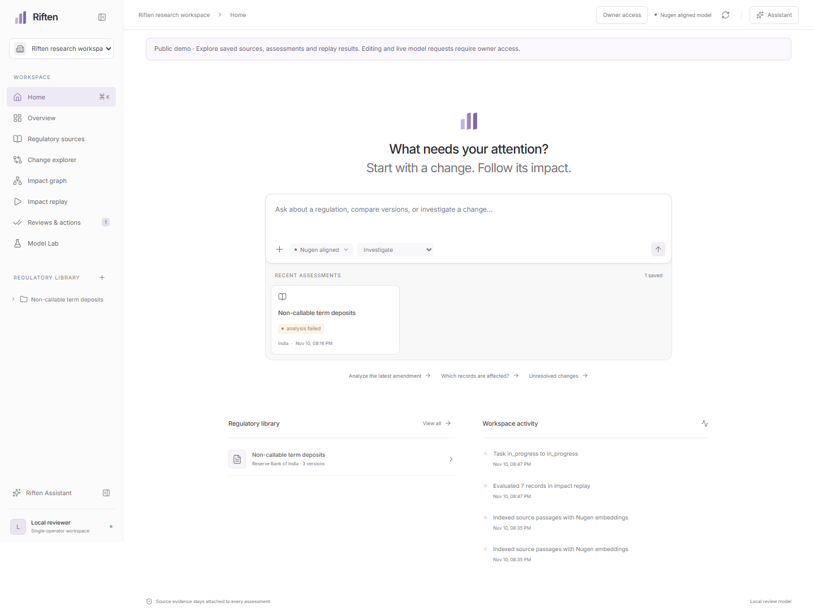
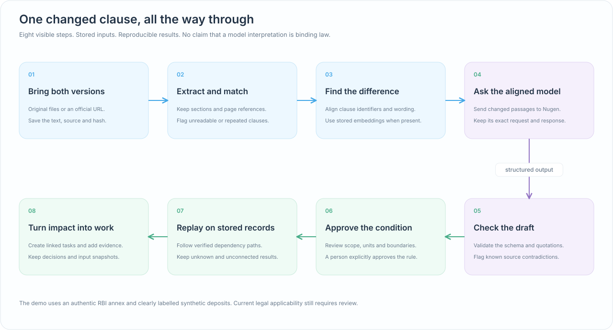
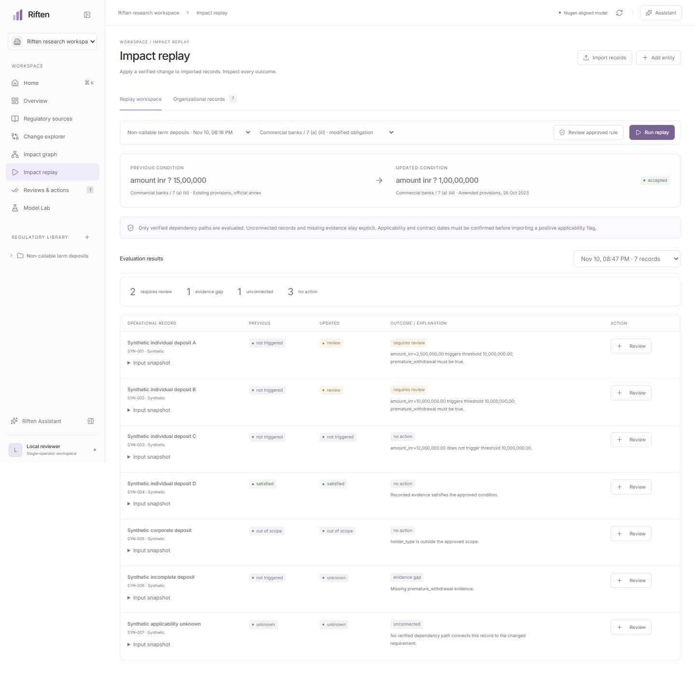
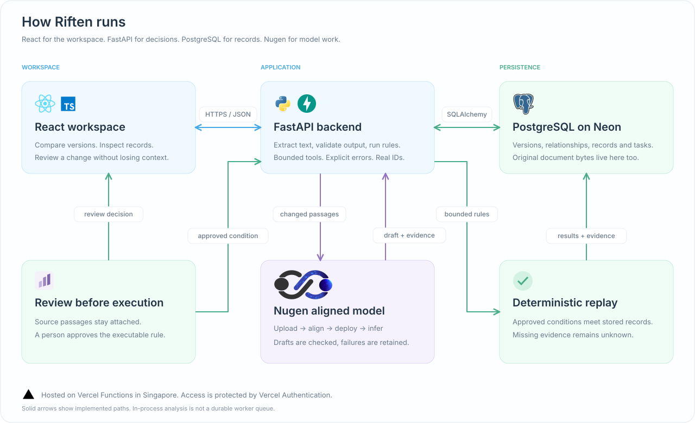
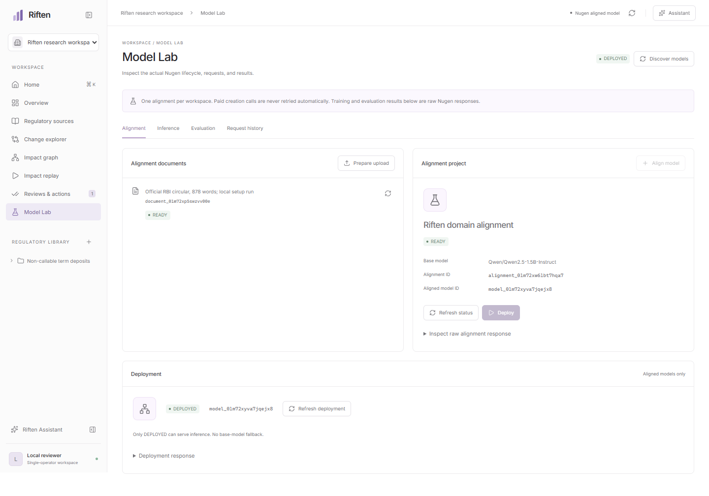

<div align="center">
  
  <h1>Riften</h1>
  <p><strong>Follow a changed rule all the way to the work it creates.</strong></p>
  <p>
    <a href="https://riften-regulatory.vercel.app">Open Riften</a> ?
    <a href="#run-it-locally">Run locally</a> ?
    <a href="#how-it-runs">Architecture</a> ?
    <a href="#what-we-actually-verified">Verified results</a>
  </p>
  <p>
    &nbsp;&nbsp;
    &nbsp;&nbsp;
    &nbsp;&nbsp;
    &nbsp;&nbsp;
    &nbsp;&nbsp;
    
  </p>
</div>

A small amendment can change the handling of hundreds of records. Riften keeps the original wording, the interpretation, the affected records, and the follow-up work connected, so you can inspect what changed and explain every next step.

**The hosted demo is open for viewing.** Explore the saved assessment, sources and replay results without signing in. Editing and paid Nugen requests require owner access. The research workspace uses authentic RBI material and clearly labelled synthetic deposit records.



## What you can do

- **Bring the source.** Upload PDF, DOCX or TXT, or import from an approved RBI or SEBI URL. Keep the original file, extracted passages, hashes and versions.
- **See the actual change.** Compare clauses side by side, including additions, removals, thresholds and exceptions. Inspect source passages alongside model drafts.
- **Follow the affected work.** Map a requirement to an internal policy, process, control, record and action. Every connection has an explicit rationale.
- **Test the changed condition.** Approve a bounded rule, replay it against stored records, and inspect individual outcomes. Missing information stays unknown.
- **Close the loop.** Create linked tasks, set ownership labels and dates, and record decisions with supporting evidence.
- **Inspect the model work.** Model Lab shows real Nugen document processing, alignment, deployment, inference, embeddings and evaluation responses.

## From a sentence to a next step



No model-generated code runs here. A proposed condition must fit a strict schema and be explicitly approved before the evaluator can use it. Replay follows verified relationships and stores the input rule and record snapshots with every result.

## A real example

The demonstration uses [RBI/2023-24/74, issued 26 October 2023](https://rbi.org.in/scripts/NotificationUser.aspx?Id=12555&Mode=0). Its annex publishes **Existing Provisions** and **Amended Provisions** side by side.

For the focused domestic individual term-deposit clause, the inclusive amount boundary for the mandatory premature-withdrawal facility changes:

| Original wording | Amended wording |
| :--- | :--- |
| Rupees fifteen lakh and below | Rupees one crore and below |
| INR 1,500,000 | INR 10,000,000 |

Riften preserves the complete circular and extracts both annex columns as **historical clause snapshots**. They are not presented as two full master directions. The commercial-bank and co-operative-bank clauses retain distinct labels.

In the stored synthetic dataset, the reviewed rule evaluates **seven deposits**:

| Outcome | Records | What it means |
| :--- | ---: | :--- |
| Requires review | 2 | The amended condition triggers and the required facility is absent in the test data. |
| Evidence gap | 1 | The input does not establish the required facility. |
| Unconnected | 1 | No verified dependency path connects the record to the changed requirement. |
| No action under this rule | 3 | The condition is satisfied, not triggered, or outside the reviewed scope. |

Institution, product and contract-date applicability must be confirmed separately. A synthetic `applicability_confirmed` field is a fixture assumption, not a conclusion about a real deposit. This historical example does not establish the current consolidated rule or retroactive applicability.

<details>
<summary><strong>See the stored replay results</strong></summary>



</details>

## How it runs



| Layer | Implementation | Responsibility |
| :--- | :--- | :--- |
| Workspace | React 19, TypeScript, Vite | Compact navigation, clause comparison, relationship exploration, record replay and review flows. |
| Server state | TanStack Query | Request state, refreshes, cache invalidation and visible failures. |
| API | Python, FastAPI, Pydantic | Input validation, extraction, bounded context, review operations and rule execution. |
| Data | SQLAlchemy, Alembic, PostgreSQL | Versioned records, explicit relationships, input snapshots, model history and original document bytes. |
| Model | Nugen v3 API | Domain alignment, deployment, chat inference, embeddings, rule proposals and evaluations. |
| Hosting | Vercel Functions, Neon | Same-origin frontend/API, persistent PostgreSQL and protected access. |

### Decisions that matter

**Durable data, ordinary transactions.** Connections are indexed foreign keys. Record attributes, bounded rules and raw provider payloads use JSON; relationships do not. Hosted original files are stored separately as bytes in PostgreSQL, so a cold start does not lose them. Local development uses SQLite and a separate originals directory.

**A draft stays a draft.** Model output is checked against strict schemas and stored source quotations. A narrow RBI wording guard catches known threshold and obligation-polarity contradictions. Those checks do not prove general legal correctness. Human rule approval remains a separate operation.

**Replay is deterministic.** The evaluator accepts a small allowlist of comparisons and scope predicates. It does not execute Python, SQL, arbitrary tools or model-generated programs. A missing field, unknown applicability or absent connection cannot quietly become a pass.

**Paid operations are deliberate.** Document, alignment and deployment IDs come from actual provider responses. Paid creation requests are not retried automatically. Database constraints stop duplicate alignment, benchmark and evaluation submissions. Unknown submission outcomes require inspection rather than another charge.

**Imports have boundaries.** Official URL imports use an explicit HTTPS domain allowlist, public-address checks, pinned DNS connections and no redirects. Unreadable/scanned pages are flagged, never filled with invented text. CSV/JSON imports validate rows atomically and preserve blank fields as unknown.

**Public viewing, owner-only changes.** The backend blocks public mutations before processing them, including all paid Nugen operations. Owner access uses a four-hour signed, HTTP-only, secure cookie. The Nugen key stays server-side. Reviewer names remain labels in a single-operator workflow, not a multiuser identity system.

The SVG diagrams are self-contained and were rendered for visual inspection. The [editable Excalidraw scene](docs/architecture.excalidraw) is included. Regenerate them with `python scripts/make_architecture.py`.

## What we actually verified

| Check | Result |
| :--- | :--- |
| Backend tests | 54 isolated tests, including public-access boundaries, failures and edge cases. |
| Frontend | TypeScript and production bundle build pass. |
| Browser journeys | Imports, comparisons, mapping, replay, actions, assistant, export and refresh persistence. |
| Viewports | 1440 px, 1024 px and 390 px, plus mobile workspace selection. |
| Database | Existing/fresh SQLite migrations, foreign-key checks, PostgreSQL migrations and real data transfer. |
| Hosted app | Original-file download, stored assessment, replay after refresh, model connection and successful aligned inference. |
| Browser failures | No console errors or failed requests in the recorded hosted verification. |

The [hosted verification record](docs/hosted-verification.json) contains the deployment URL, returned model ID and observed request outcomes. Test fixtures are isolated; browser-test workspaces are archived out of normal navigation.

### Nugen integration, without the success theatre

One 878-word official corpus was uploaded. One Qwen2.5 1.5B alignment reached `READY`, and its returned model reached `DEPLOYED`. Real chat inference succeeded. Both annex snapshots produced four 768-dimensional passage embeddings each. One five-question base-versus-aligned evaluation completed.

**The model's quality was poor.** Its free-form drafts included incorrect interpretations, and an incorrect proposed rule was rejected. The provider's tiny generated benchmark reported binary-correctness mean **0.0 for both models**, with relevance mean **0.3 aligned / 0.4 base** and **4 / 5 valid judgments**. No model-improvement claim is made.

The working replay uses a separately reviewed source formalization. Invalid model outputs remain visible. Raw provider responses also contain inconsistent document/sample counters; they are preserved, not rewritten to look successful.

<details>
<summary><strong>Open Model Lab</strong></summary>



</details>

## Run it locally

Python 3.12 and Node 24 are the hosted/CI targets. Local checks were also run on Python 3.11. These commands use PowerShell:

```powershell
git clone https://github.com/darved2305/Riften.git
cd Riften
python -m venv .venv
.venv/Scripts/python -m pip install -r requirements-lock.txt
npm ci
if (!(Test-Path .env)) { Copy-Item .env.example .env }
.venv/Scripts/python -m alembic upgrade head
```

Set `NUGEN_API_KEY` in `.env` for Nugen operations. Keep it out of browser code and version control. Extraction, comparisons, manual mapping, approved replay and reviews work without it.

Start the backend and frontend in separate terminals:

```powershell
.venv/Scripts/python -m uvicorn backend.main:app --host 127.0.0.1 --port 8000
```

```powershell
npm run dev
```

Open **http://127.0.0.1:5173**. API schemas are at **http://127.0.0.1:8000/docs**. After setup, `./Start-Riften.ps1` can start both processes with hidden windows and local logs.

A fresh clone starts empty. Create a workspace and import the official RBI example from Regulatory sources. The optional synthetic CSV is at [`public/sample-records.csv`](public/sample-records.csv). Model Lab can upload extracted text of at least 500 words, discover supported models, align once, deploy, and test the returned model. Existing remote models are not fabricated or silently substituted.

### Checks

```powershell
.venv/Scripts/python -m pytest -q
npm run build
```

`npm run test:e2e` exercises a prepared local research workspace and writes labelled synthetic test records. It requires both servers, Playwright Chromium and `data/demo-workspace.json`; its assistant step makes a real Nugen request. GitHub Actions runs the isolated backend tests and frontend build without provider credentials.

### Deploy

`server.py` serves the built React client and the FastAPI routes from one origin. `pyproject.toml` defines the Python runtime and build, while `vercel.json` selects Singapore execution and excludes runtime data and secrets from the bundle. The build applies Alembic migrations against the configured database.

Required hosted settings:

```text
DATABASE_URL       PostgreSQL connection URL, managed by the Neon integration
NUGEN_API_KEY      Nugen API credential, stored as a Vercel secret
RIFTEN_PUBLIC_DEMO 1 to enable read-only public viewing
RIFTEN_OWNER_TOKEN A long random owner key, stored as a Vercel secret
```

The hosted file limit is **4 MB**; local file imports accept up to **15 MB**. The included data-transfer script copies one selected workspace into an empty PostgreSQL database and verifies original source hashes. It refuses to overwrite a populated target or create paid model jobs.

## Repository layout

```text
src/                         React workspace, shared UI and API client
backend/
  ingestion.py               Text extraction and official-source imports
  intelligence.py            Clause matching, output checks and bounded rules
  nugen.py                   Nugen transport and inference history
  models.py / db.py          Relational models and database configuration
  main.py                    Validated application endpoints
migrations/                  Versioned schema changes
server.py                    Hosted entrypoint and frontend mount
tests/                       Isolated integrity and failure tests
scripts/                     Browser checks, transfer and diagram generation
docs/assets/                 Actual screenshots, diagrams and technology logos
docs/architecture.excalidraw  Editable diagram source
```

## Deliberate limits

This is a working, protected demonstration, not a finished enterprise deployment. Model reliability needs a better curated corpus and expert-labelled evaluation. There is no durable job queue, OCR, notification service, application-level tenant authorization or automated source subscription. Pending analysis runs in-process and can be interrupted by a restart. Remote model work continues independently and can be refreshed using stored IDs.

Source checks run on demand. Pending Nugen jobs are polled while Model Lab is open. Tables are not yet paginated for large datasets. Export is a reproducible JSON bundle. Relationship mappings are explicitly reviewed, not proof of causality inferred from text similarity.

### Sources and assets

The regulatory source is the [official RBI circular and annex](https://rbi.org.in/scripts/NotificationUser.aspx?Id=12555&Mode=0). Nugen requests follow the [current documentation](https://docs.nugen.in/) and [cookbook](https://github.com/nugen-in/nugen-cookbook). The requirement-change approach was informed by [Barrientos, Winter and Rinderle-Ma (2026)](https://doi.org/10.1016/j.infsof.2026.108079), without claiming to implement its full formal process-checking method.

Technology logos come from [Devicon](https://github.com/devicons/devicon) and Nugen's official documentation. Marks identify the actual stack and remain the property of their owners. Asset sources are recorded in [`NOTICE.txt`](docs/assets/logos/NOTICE.txt).
